<div dir="rtl">

<p align="center">
  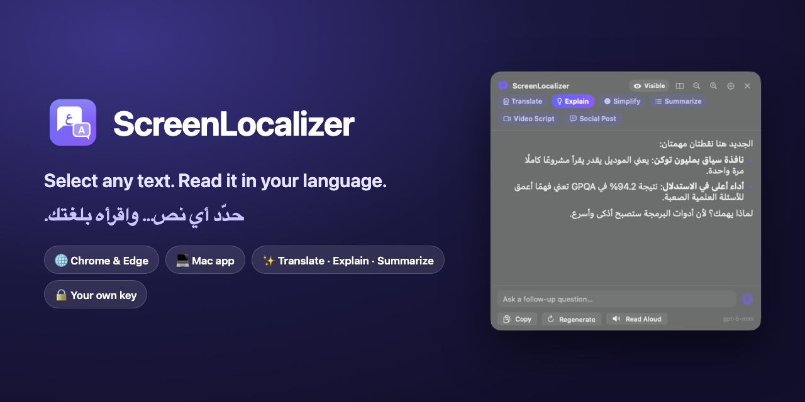
</p>

<p align="center">
  <a href="README.md"><b>🇬🇧 Read this guide in English</b></a> ·
  <a href="#-التحميل">التحميل</a> ·
  <a href="#-الجزء-الأول--إضافة-المتصفح">دليل الإضافة</a> ·
  <a href="#-الجزء-الثاني--تطبيق-الماك">دليل تطبيق الماك</a> ·
  <a href="#-أسئلة-وأجوبة">أسئلة وأجوبة</a>
</p>

<p align="center">
  <a href="https://github.com/eyoussef-builds/screenlocalizer/releases/latest"></a>
  <a href="LICENSE"></a>
  
  
</p>

---

## 👋 ما هو ScreenLocalizer؟

تخيّل أن لديك صديقًا يتكلم **الإنجليزية ولغتك**. كلما أشرت إلى شيء مكتوب بالإنجليزية — مقال إخباري، أو ملف
PDF، أو تغريدة، أو حتى كلمات داخل صورة أو فيديو متوقف — يميل صديقك نحوك ويخبرك **ماذا يقول النص، وماذا يعني،
أو يعطيك الخلاصة**.

**ScreenLocalizer هو هذا الصديق، لكنه يعيش داخل جهازك.**

1. **تحدّد** نصًا (أو ترسم مربعًا حوله على الشاشة).
2. تضغط زرًا صغيرًا أو اختصارًا من لوحة المفاتيح.
3. تظهر نافذة صغيرة فيها النص **مترجمًا، أو مشروحًا، أو مبسّطًا، أو ملخّصًا** بلغتك.

<p align="center">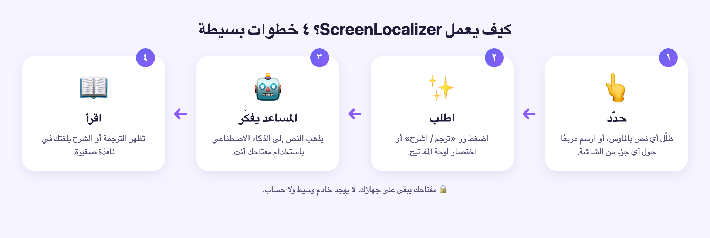</p>

صُمّم في الأصل **لصنّاع المحتوى** الذين يقرؤون الأخبار التقنية بالإنجليزية ويقدّمونها لجمهورهم بلغة أخرى (مثل
العربية)، لكنه مفيد لكل من يقرأ بالإنجليزية ويفكّر بلغة أخرى: الطلاب، والباحثين، وكل شخص فضولي.

### ماذا يستطيع أن يفعل؟

| الوضع | ماذا تحصل عليه | الإضافة | تطبيق الماك |
|---|---|:---:|:---:|
| 📘 **ترجمة** | ترجمة طبيعية تُبقي المصطلحات التقنية مثل "AI agent" بالإنجليزية | ✅ | ✅ |
| 💡 **شرح** | ليست ترجمة حرفية: *ماذا يعني الكلام ولماذا يهمك*، كأنك تشرحه أمام الكاميرا | ✅ | ✅ |
| 🙂 **تبسيط** | الفكرة بكلمات بسيطة جدًا مع مثال من الحياة اليومية | ✅ | ✅ |
| 📝 **تلخيص** | من ٣ إلى ٦ نقاط قصيرة | ✅ | ✅ |
| 🎬 **سكربت فيديو** | نص جاهز للقراءة في فيديوك القادم | | ✅ |
| 💬 **منشور** | تغريدة (منشور X) ومنشور LinkedIn عن الخبر | | ✅ |
| ❓ **أسئلة متابعة** | اسأل «ماذا يعني هذا؟» عن نفس النص | | ✅ |

يمكن أن تكون النتائج **بالعربية أو بأي لغة أخرى تقريبًا** — أنت تختار.

---

## 🧩 نسختان — اختر واحدة (أو استخدم الاثنتين)

| | 🌐 **إضافة المتصفح** | 💻 **تطبيق الماك** |
|---|---|---|
| **تعمل في** | صفحات الويب داخل Chrome أو Microsoft Edge (ويندوز وماك ولينكس) | **كل التطبيقات** على الماك: المتصفحات، وملفات PDF، والملاحظات، وSlack، وتيليجرام… والنصوص داخل الصور والفيديو |
| **كيف تشغّلها** | حدّد نصًا ← زر بنفسجي | حدّد نصًا ← اختصار `⌃⌥T`، أو زر عائم، أو مربع الشاشة `⌃⌥O`، أو صندوق اللصق `⌃⌥V` |
| **مزايا إضافية** | — | نافذة مخفية عن التسجيل، أسئلة متابعة، قراءة صوتية، سجل وتصدير، مصطلحات، سكربت فيديو، منشورات |
| **خدمات الذكاء الاصطناعي** | OpenAI | OpenAI أو أي خدمة متوافقة معها (OpenRouter وGroq وOllama…) |
| **تحتاج إلى** | متصفح Chrome أو Edge | ماك بمعالج Apple (‏M1 أو أحدث) ونظام macOS 14 ‏(Sonoma) أو أحدث |

النسختان **مجانيتان للاستخدام الشخصي فقط** (انظر [الترخيص](#-الترخيص)).

---

## 📥 التحميل

| ماذا | رابط التحميل |
|---|---|
| 🌐 إضافة المتصفح | [**ScreenLocalizer-extension.zip**](https://github.com/eyoussef-builds/screenlocalizer/releases/latest/download/ScreenLocalizer-extension.zip) |
| 💻 تطبيق الماك | [**ScreenLocalizer-mac.dmg**](https://github.com/eyoussef-builds/screenlocalizer/releases/latest/download/ScreenLocalizer-mac.dmg) |

كل الإصدارات وملاحظاتها: [صفحة الإصدارات](https://github.com/eyoussef-builds/screenlocalizer/releases).

---

## 🔑 قبل أن تبدأ: احصل على مفتاح الذكاء الاصطناعي (حوالي ٥ دقائق)

**الفكرة ببساطة:** ScreenLocalizer ليس له «عقل» خاص به، بل **يستعير** عقلًا من شركة ذكاء اصطناعي — وهي افتراضيًا
**OpenAI**، الشركة التي صنعت ChatGPT. ولكي تستعيره تحتاج إلى **مفتاح**: كلمة سر طويلة وسرّية تبدأ بـ `sk-`.
وتحاسبك OpenAI على مبلغ صغير جدًا مقابل ما تستخدمه.

> 💰 **كم التكلفة؟** ترجمة أو شرح فقرة واحدة تكلّف عادةً **أقل من سنت واحد**، ورصيد ٥ دولارات يكفي معظم الناس
> وقتًا طويلًا.
>
> ⚠️ **اشتراك ChatGPT Plus ليس هو نفس الشيء.** الاشتراك في ChatGPT *لا* يشمل رصيد الـ API، فالمفتاح يحتاج رصيدًا
> صغيرًا خاصًا به.

**خطوة بخطوة:**

1. ادخل إلى **<https://platform.openai.com>** وأنشئ حسابًا أو سجّل الدخول (يمكنك استخدام حساب ChatGPT نفسه).
2. افتح **Settings ← Billing** (الإعدادات ← الفوترة)، وأضف وسيلة دفع ورصيدًا صغيرًا (مثلًا ٥ دولارات).
3. افتح **<https://platform.openai.com/api-keys>** واضغط **Create new secret key** (إنشاء مفتاح سري جديد).
4. سمِّه مثلًا `ScreenLocalizer` ثم اضغط **Create secret key**.
5. اضغط **Copy** (نسخ). شكل المفتاح يشبه `sk-proj-…` وهو طويل جدًا.
6. احفظه في مكان آمن (مثل مدير كلمات المرور). **OpenAI تعرضه مرة واحدة فقط**، وأي شخص يحصل عليه يستطيع إنفاق
   رصيدك — **لا تشاركه مع أحد ولا تنشره أبدًا**.

ستلصق هذا المفتاح في ScreenLocalizer بعد قليل. يبقى المفتاح **على جهازك** ولا يُرسَل إلا إلى OpenAI.

---

## 🌐 الجزء الأول — إضافة المتصفح

### كيف تعمل؟ (شرح بسيط كأنك طفل في الخامسة)

عندما تفتح صفحة ويب، تنتظر الإضافة بهدوء في الخلفية. وفي اللحظة التي تظلّل فيها كلمات بالماوس، يظهر بجانبها زر
بنفسجي صغير: **«ترجم / اشرح»**.

<p align="center">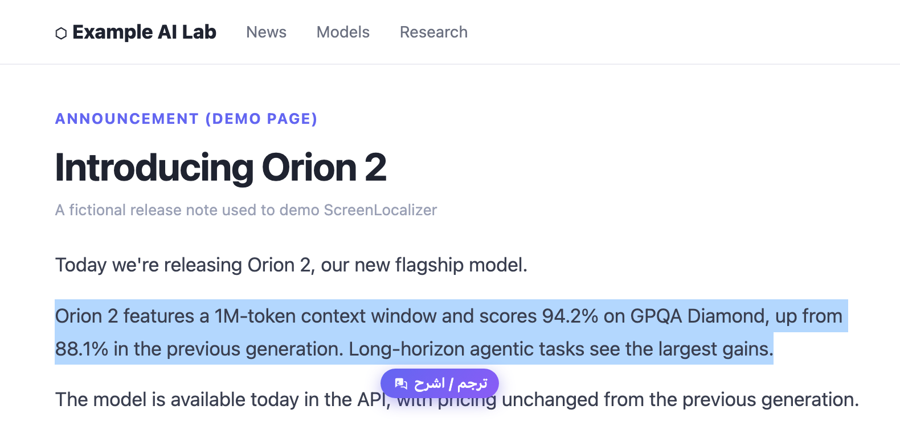</p>

اضغط عليه، فتنفتح نافذة صغيرة بجانب كلماتك. ترسل الإضافة **هذه الكلمات فقط** إلى OpenAI (باستخدام مفتاحك)،
ويظهر الرد في النافذة **كلمة بكلمة، كأن أحدًا يكتبه لك الآن**. تريد نوعًا آخر من الرد؟ اضغط وضعًا آخر في الأعلى:
**ترجمة** أو **شرح** أو **تبسيط** أو **تلخيص**.

<p align="center">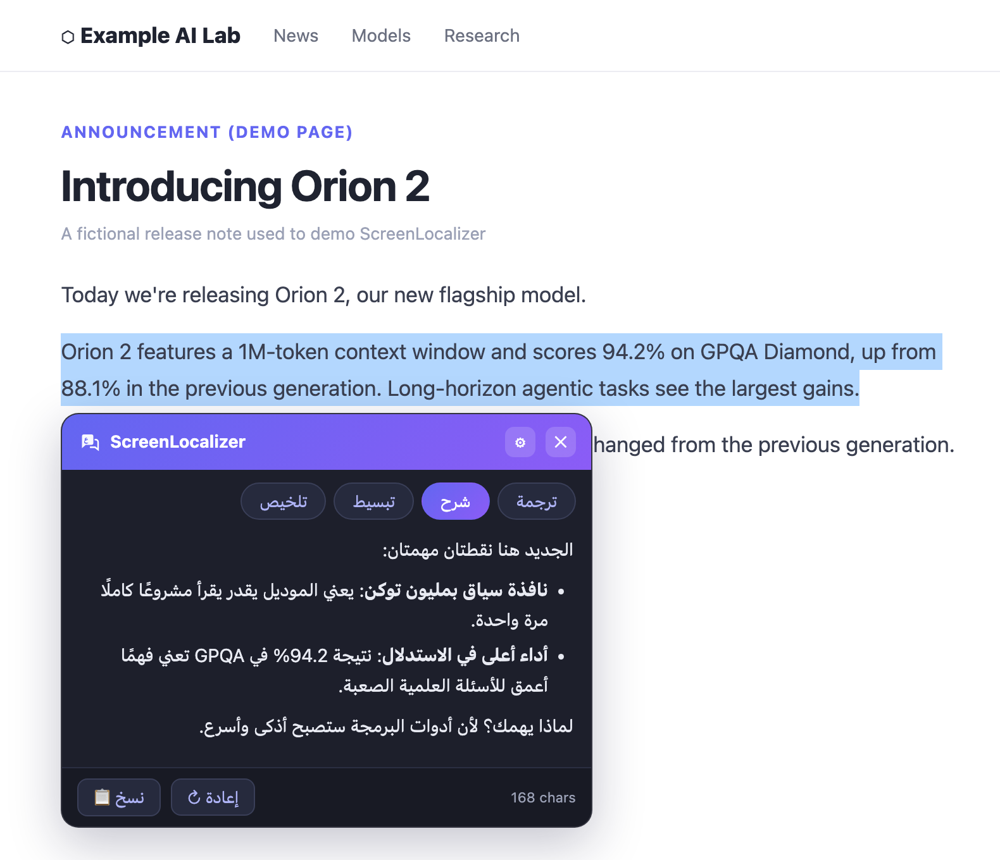</p>

<details>
<summary><b>🔧 للكبار الفضوليين: ماذا يحدث خلف الكواليس؟</b></summary>

- الملف `content.js` يعمل في كل صفحة: يلاحظ النص الذي حددته، ويُظهر الزر، ويرسم نافذة النتيجة داخل *Shadow DOM
  مغلق* حتى لا تفسدها تنسيقات الصفحة (ولا تفسد هي الصفحة).
- الملف `background.js` (عامل الخدمة) يستقبل النص، ويجهّز التعليمات المناسبة للوضع المختار، ويستقبل الرد من OpenAI
  تدريجيًا (Streaming) ويرسله إلى النافذة.
- مفتاحك وإعداداتك محفوظة في تخزين الإضافة داخل متصفحك على جهازك.
- لا يُرسَل أي شيء حتى تضغط الزر أو تستخدم قائمة الزر الأيمن أو الاختصار.

</details>

### التثبيت — خطوة بخطوة

> الإضافة ليست في متجر Chrome بعد، لذلك تثبّتها بخيار **Load unpacked** (تحميل غير مضغوط) في Chrome. يبدو الأمر
> تقنيًا، لكنه بضع نقرات فقط.

1. **حمّل** ملف [ScreenLocalizer-extension.zip](https://github.com/eyoussef-builds/screenlocalizer/releases/latest/download/ScreenLocalizer-extension.zip).
2. **فك الضغط عنه:**
   - **على الماك:** انقر عليه مرتين، فيظهر مجلد اسمه `ScreenLocalizer-extension`.
   - **على ويندوز:** انقر عليه بالزر الأيمن ← **Extract All…** (استخراج الكل) ← **Extract**.
3. **انقل هذا المجلد إلى مكان دائم**، مثل مجلد **المستندات (Documents)**. المتصفح يشغّل الإضافة من هذا المجلد في
   كل مرة، لذلك **لا تحذفه**.
4. افتح **Chrome** واكتب `chrome://extensions` في شريط العنوان، ثم اضغط **Enter**.
   (في **Microsoft Edge** اكتب `edge://extensions`).
5. فعّل **Developer mode** (وضع المطوّر) — وهو مفتاح في **أعلى يمين** الصفحة في Chrome، وفي Edge تجده في
   **الشريط الجانبي**.
6. اضغط **Load unpacked** واختر مجلد `ScreenLocalizer-extension`.
7. **ثبّت أيقونتها** لتجدها بسهولة: اضغط أيقونة قطعة البازل 🧩 بجانب شريط العنوان، ثم الدبوس 📌 بجانب
   **ScreenLocalizer**.
8. ستنفتح **صفحة الإعدادات** تلقائيًا (وإن لم تنفتح: اضغط أيقونة ScreenLocalizer ← **⚙️ الإعدادات**).
   الصق مفتاحك في خانة **مفتاح OpenAI API**، واضغط **حفظ**، ثم **اختبار المفتاح**. يجب أن ترى **✓ المفتاح يعمل**.

<p align="center">
  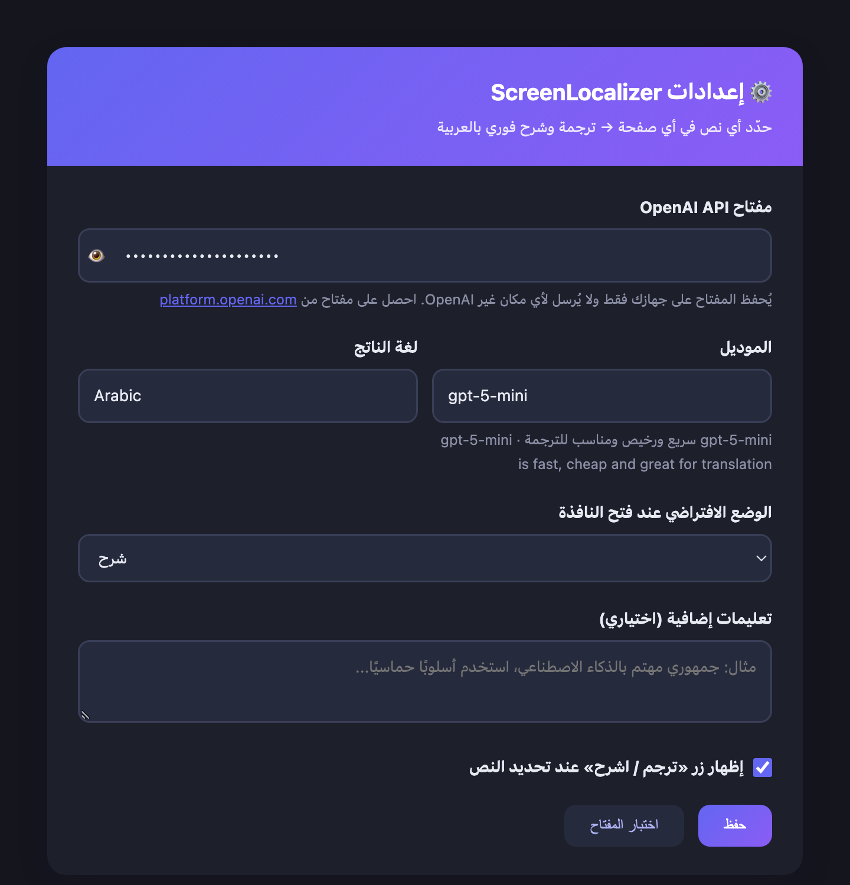
  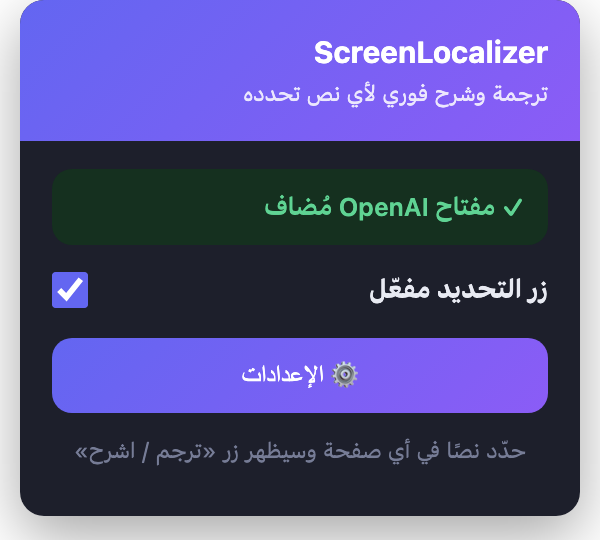
</p>

🎉 **انتهينا!** افتح أي مقال بالإنجليزية، وحدّد جملة، واضغط الزر البنفسجي.

### الاستخدام

- **حدّد نصًا ← اضغط «ترجم / اشرح».** تنفتح النافذة بجانب النص.
- **بدّل بين الأوضاع** بالأزرار أعلى النافذة. كل رد يُحفَظ ما دامت النافذة مفتوحة، فالرجوع إليه فوري.
- **📋 نسخ** لنسخ الرد، و **↻ إعادة** لطلب رد جديد.
- **حرّك النافذة** بسحب شريطها البنفسجي العلوي، وأغلقها بـ **✕** أو بمفتاح **Esc**.
- **طرق أخرى للتشغيل:** انقر بالزر الأيمن على النص المحدد ← **ScreenLocalizer: ترجم أو اشرح**، أو اضغط
  **Ctrl + Shift + Y** (ويندوز) / **⌘ + Shift + Y** (ماك).
- **الإعدادات** (أيقونة الإضافة ← ⚙️):
  - **لغة الناتج** — العربية افتراضيًا، ويمكنك كتابة أي لغة مثل `French`.
  - **الموديل** — `gpt-5-mini` افتراضيًا: سريع ورخيص وممتاز في الترجمة.
  - **الوضع الافتراضي** — أي وضع يظهر أولًا.
  - **تعليمات إضافية** — مثل: «جمهوري مهتم بالذكاء الاصطناعي، استخدم أسلوبًا بسيطًا».
  - يمكنك إيقاف الزر العائم إذا أردت الاكتفاء بقائمة الزر الأيمن أو الاختصار.

### التحديث

1. حمّل ملف zip الجديد وفك الضغط عنه.
2. استبدل الملفات داخل مجلد `ScreenLocalizer-extension` بالملفات الجديدة.
3. افتح `chrome://extensions` واضغط سهم **↻ إعادة التحميل** على بطاقة ScreenLocalizer. مفتاحك وإعداداتك تبقى كما هي.

---

## 💻 الجزء الثاني — تطبيق الماك

### كيف يعمل؟ (شرح بسيط كأنك طفل في الخامسة)

تطبيق الماك هو نفس الصديق المساعد، لكنه لا يعيش داخل متصفح واحد، بل يعيش في **شريط القوائم أعلى الشاشة** (ابحث
عن أيقونة فقاعة كلام صغيرة)، لذلك يستطيع مساعدتك **في كل التطبيقات**.

يمكنك استدعاؤه **بأربع طرق**:

| الطريقة | ماذا تفعل | مفيدة في |
|---|---|---|
| ⌨️ **الاختصار** | حدّد نصًا في أي مكان، ثم اضغط **⌃⌥T** | أسرع طريقة، في أي تطبيق |
| 🟣 **الزر العائم** | حدّد نصًا فيظهر زر «ترجم / اشرح»، اضغطه | مثل الإضافة، لكن في كل مكان |
| 🔲 **مربع الشاشة (OCR)** | اضغط **⌃⌥O** ثم ارسم مربعًا حول **أي** نص على الشاشة | النصوص التي لا يمكن تحديدها: الصور، والشرائح، ولقطات الفيديو، والرسوم البيانية |
| 📋 **صندوق اللصق** | اضغط **⌃⌥V**، والصق النص أو اكتبه، ثم اضغط **⌘↩** | نص من أي مصدر آخر |

> **ماذا يعني ⌃ و ⌥؟** الرمز ⌃ هو مفتاح **Control**، والرمز ⌥ هو مفتاح **Option** (أسفل يسار لوحة المفاتيح).
> «⌃⌥T» تعني: **اضغط Control وOption معًا واستمر بالضغط، ثم اضغط حرف T**.

<p align="center">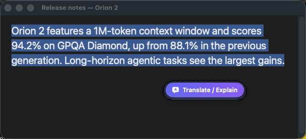</p>

<p align="center">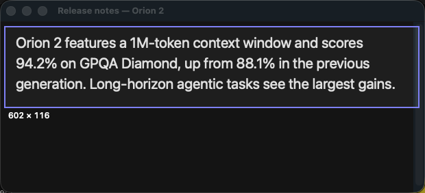</p>

بعدها تُظهر نافذة صغيرة — نسمّيها **اللوحة** — الرد. تطفو اللوحة فوق نوافذك الأخرى **دون أن تسحب التركيز** من
التطبيق الذي تقرأ فيه.

<p align="center">
  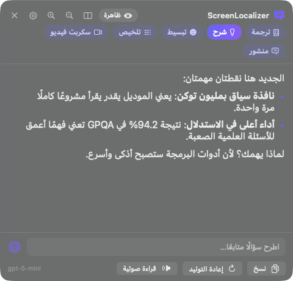
  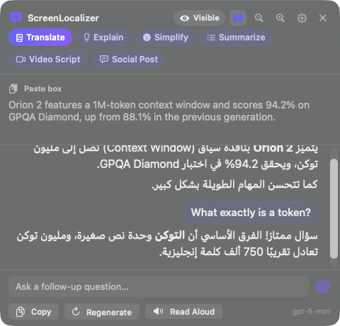
</p>

**🔒 جهاز التلقين السري الخاص بك (Teleprompter).** افتراضيًا تكون اللوحة **مخفية**: نظام macOS يستبعدها من لقطات
الشاشة وتسجيلات الشاشة التي تتم عبر نظام الالتقاط القياسي (المستخدم في أداة لقطات الشاشة المدمجة وQuickTime وOBS
ومعظم برامج التسجيل الحديثة). تستطيع قراءة الترجمة أثناء التسجيل، بينما يرى جمهورك الصفحة الإنجليزية فقط. اضغط
شارة **مخفية** أعلى اللوحة لتصبح **ظاهرة** عندما *تريد* أن يراها جمهورك.
*نصيحة: سجّل تجربة مدتها ٥ ثوانٍ ببرنامج التسجيل الخاص بك قبل أي تسجيل مهم.*

<details>
<summary><b>🔧 للكبار الفضوليين: ماذا يحدث خلف الكواليس؟</b></summary>

- **قراءة النص المحدد:** يطلب التطبيق النص المحدد من نظام «تسهيلات الاستخدام» في macOS. وإذا كان التطبيق لا يشاركه،
  يرسل ScreenLocalizer اختصار ⌘C للحظة، ويقرأ الحافظة، ثم **يعيد محتوى حافظتك كما كان**.
- **مربع الشاشة:** تُلتقط المنطقة التي ترسمها باستخدام ScreenCaptureKit (مع استبعاد نوافذ ScreenLocalizer نفسها)،
  وتُقرأ **على جهازك** بتقنية Vision من Apple. النص المقروء فقط هو ما يذهب إلى الذكاء الاصطناعي، والصورة لا تُحفَظ
  ولا تُرفَع أبدًا.
- **الذكاء الاصطناعي:** يُرسَل النص مع تعليمات الوضع المختار إلى واجهة Chat Completions متوافقة مع OpenAI ويصل الرد
  تدريجيًا. ومفتاحك محفوظ في **سلسلة مفاتيح macOS** (Keychain).
- **الوضع المخفي:** تُعلَّم اللوحة في النظام على أنها مستبعدة من التقاط الشاشة.
- **السجل** ملف على جهازك، ولا تتم مزامنته مع أي مكان.

</details>

### التثبيت — خطوة بخطوة

**تحتاج إلى:** ماك بمعالج **Apple** (‏M1 أو M2 أو M3 أو M4 أو أحدث) ونظام **macOS 14 ‏(Sonoma) أو أحدث**.
(لست متأكدًا؟ اضغط قائمة Apple في أعلى يسار الشاشة ← **حول هذا الماك**، وستجد «الشريحة» و«macOS»).

1. **حمّل** ملف [ScreenLocalizer-mac.dmg](https://github.com/eyoussef-builds/screenlocalizer/releases/latest/download/ScreenLocalizer-mac.dmg).
2. **انقر مرتين** على الملف الذي حمّلته، فتنفتح نافذة فيها أيقونة ScreenLocalizer ومجلد **Applications** (التطبيقات).
3. **اسحب** أيقونة ScreenLocalizer **وأفلتها على مجلد Applications**، ثم أغلق تلك النافذة.
4. افتح مجلد **التطبيقات** (Finder ← التطبيقات) و**انقر مرتين على ScreenLocalizer**.
5. سيعرض macOS رسالة مثل **«لم تتمكن Apple من التحقق من ScreenLocalizer…»**. هذا متوقَّع، لأن التطبيق غير موقّع بعد
   بشهادة مطوّر مدفوعة من Apple. اضغط **تم (Done)** — *وليس* «نقل إلى سلة المهملات».
6. افتح قائمة Apple (أعلى يسار الشاشة) ← **إعدادات النظام** ← **الخصوصية والأمان**. انزل إلى قسم **الأمان** وستجد
   عبارة *«تم حظر ScreenLocalizer لحماية جهاز الماك»*. اضغط **فتح على أي حال (Open Anyway)**، ثم أدخل كلمة سر الماك
   (أو استخدم Touch ID)، واضغط **فتح على أي حال** مرة أخرى.
7. تظهر **نافذة الترحيب**. 🎉 الخطوتان ٥ و٦ تحتاجهما مرة واحدة فقط.

### الإعداد لأول مرة — خطوة بخطوة

تأخذك نافذة الترحيب في خمس خطوات قصيرة. (إذا كان نظامك بالعربية ستظهر النوافذ بالعربية كما في الصورة الأولى).

<p align="center">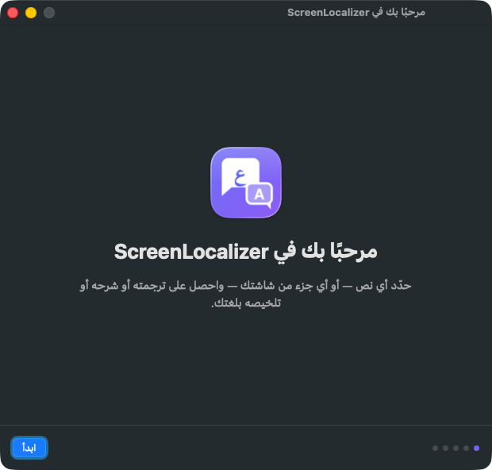</p>

**١. الترحيب** ← اضغط **ابدأ (Get Started)**.

**٢. اختر لغتك.** اختر اللغة التي تريد الردود بها (مثلًا *العربية — Arabic*)، ثم **متابعة**.

<p align="center">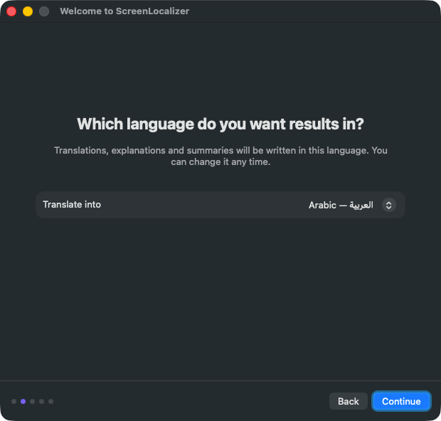</p>

**٣. اربط الذكاء الاصطناعي.** اترك **المزوّد (Provider)** على **OpenAI**. الصق مفتاحك في خانة **مفتاح API**، واضغط
**حفظ المفتاح**، ثم **اختبار الاتصال**. عندما ترى **✓ متصل** اضغط **متابعة**.
(يختار التطبيق نموذجًا مناسبًا تلقائيًا، و`gpt-5-mini` خيار افتراضي ممتاز).

<p align="center">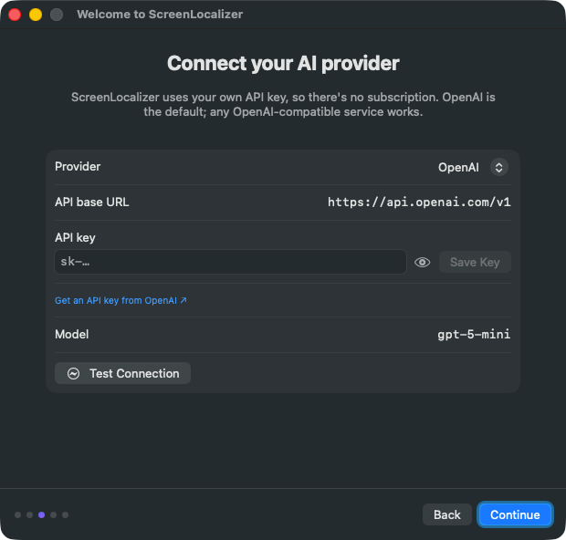</p>

**٤. السماح بالوصول.** نظام macOS يحمي شاشتك وتطبيقاتك، لذلك يطلب منك *أنت* السماح بأمرين:

<p align="center">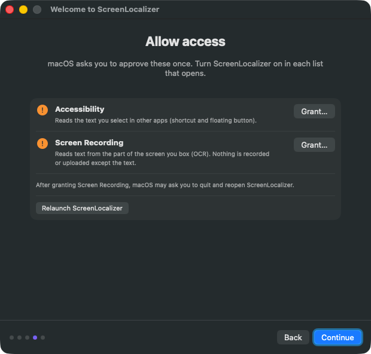</p>

- **تسهيلات الاستخدام (Accessibility)** — تسمح لـ ScreenLocalizer بقراءة النص الذي تحدده في التطبيقات الأخرى.
  اضغط **منح…**، فتنفتح إعدادات النظام على **الخصوصية والأمان ← تسهيلات الاستخدام**. ابحث عن **ScreenLocalizer**
  في القائمة و**فعّله** (وأدخل كلمة السر إن طُلبت).
- **تسجيل الشاشة (Screen Recording)** — تسمح لـ ScreenLocalizer بقراءة النص داخل المربع الذي ترسمه.
  اضغط **منح…**، وفعّل **ScreenLocalizer** في **الخصوصية والأمان ← تسجيل الشاشة وصوت النظام** (اسمها **تسجيل الشاشة**
  في macOS 14). وإذا قال النظام إن التطبيق يجب أن **يُغلق ويُعاد فتحه**، اضغط **إنهاء وإعادة فتح** (أو استخدم زر
  **إعادة تشغيل ScreenLocalizer**).

تتحول العلامات البرتقالية إلى ✓ خضراء عند منح الإذن، ثم اضغط **متابعة**.

> 🤔 **هل هذا آمن؟** إذن تسهيلات الاستخدام يُستخدم فقط لقراءة النص الذي *أنت* تحدده، وإذن تسجيل الشاشة يُستخدم فقط
> لالتقاط المربع الذي *أنت* ترسمه. ScreenLocalizer لا يسجّل فيديو أبدًا، ولا يُرسل شيئًا سوى النص إلى خدمة الذكاء
> الاصطناعي التي اخترتها.

**٥. كل شيء جاهز!** اترك خيار **فتح ScreenLocalizer عند تسجيل الدخول** مفعّلًا إذا أردته جاهزًا كلما شغّلت الماك، ثم
اضغط **ابدأ استخدام ScreenLocalizer**.

<p align="center">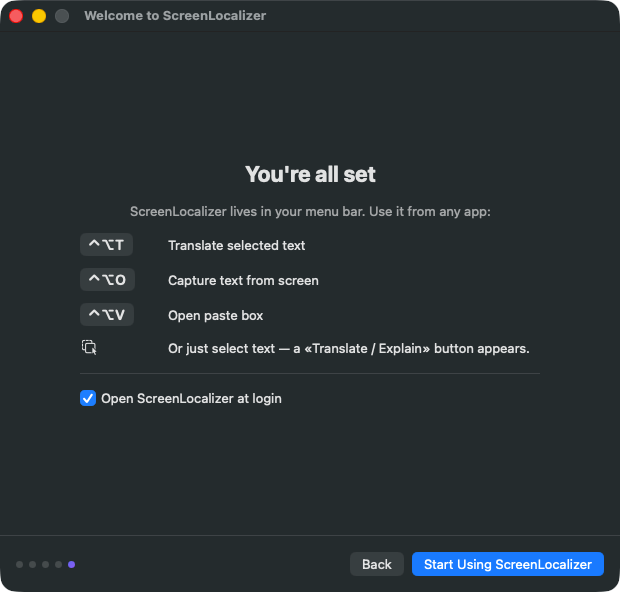</p>

يعيش ScreenLocalizer الآن في **شريط القوائم** (أعلى يمين الشاشة). جرّبه: حدّد أي جملة إنجليزية — حتى في هذه الصفحة —
واضغط **⌃⌥T**.

### الاستخدام

#### اللوحة

| الزر | ماذا يفعل |
|---|---|
| **مخفية / ظاهرة** | إخفاء اللوحة عن تسجيلات الشاشة (مخفية) أو إظهارها (ظاهرة) |
| ▭▭ | عرض **النص الأصلي جنبًا إلى جنب** مع الرد |
| 🔍− / 🔍+ | **تصغير أو تكبير** النص (ممتاز كجهاز تلقين) |
| ⚙️ | فتح **الإعدادات** |
| ✕ | إغلاق اللوحة (أو اضغط **Esc**) |
| أزرار الأوضاع | **ترجمة · شرح · تبسيط · تلخيص · سكربت فيديو · منشور** |
| *اطرح سؤالًا متابعًا…* | اكتب سؤالًا عن نفس النص واضغط **Return** |
| **نسخ** | نسخ الرد (مع أسئلة المتابعة) |
| **إعادة التوليد** | الحصول على رد جديد |
| **قراءة صوتية** | الاستماع إلى الرد (اضغط مرة أخرى للإيقاف) |

يمكنك **سحب** اللوحة من أعلاها و**تغيير حجمها** من حوافها. وما دامت مفتوحة، تظهر الردود الجديدة في المكان نفسه.

<p align="center">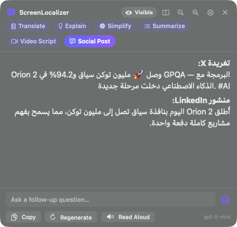</p>

#### أيقونة شريط القوائم

اضغط أيقونة فقاعة الكلام في شريط القوائم لتجد: **ترجمة النص المحدد**، و**التقاط نص من الشاشة…**، و**صندوق اللصق**،
و**عرض آخر نتيجة**، و**الوضع الافتراضي**، وتشغيل أو إيقاف **الزر العائم**، و**إخفاء النافذة من تسجيلات الشاشة**،
و**السجل…**، و**الإعدادات…**، و**التحقق من التحديثات…**.

#### السجل

كل رد يُحفَظ **على جهازك** لتجده لاحقًا: أيقونة شريط القوائم ← **السجل…**. يمكنك البحث، والتصفية حسب الوضع،
والنسخ، وإعادة الفتح في اللوحة، أو **تصدير** جلسة كاملة كملف Markdown واحد — مفيد كسكربت لفيديوك القادم.

<p align="center">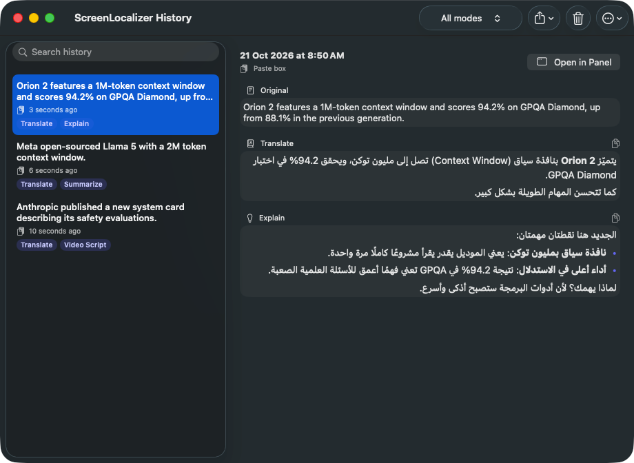</p>

#### الإعدادات

أيقونة شريط القوائم ← **الإعدادات…**

| التبويب | ماذا يمكنك تغييره |
|---|---|
| **عام** | لغة الردود، والوضع الافتراضي، والتعليمات المخصصة، والإخفاء الافتراضي للوحة، وحجم النص، وتشغيل السجل، ولغة الواجهة (English / العربية)، والفتح عند تسجيل الدخول |
| **الذكاء الاصطناعي** | المزوّد (OpenAI وOpenRouter وGroq وOllama وLM Studio ومخصص)، ورابط الـ API، والمفتاح، والنموذج، واختبار الاتصال |
| **طرق التشغيل** | تغيير الاختصارات الثلاثة، وتشغيل/إيقاف الزر العائم، وماذا يحدث عند نسخ نص |
| **المصطلحات** | قائمتك الخاصة مثل `agent ← وكيل ذكي`، لتستخدم كل الردود نفس المصطلحات |
| **الصوت** | القراءة بأصوات macOS المجانية أو بأصوات OpenAI الطبيعية |
| **الأذونات** | معرفة هل إذنا تسهيلات الاستخدام وتسجيل الشاشة ممنوحان |
| **حول** | رقم الإصدار، والروابط، و**التحقق من التحديثات** |

<p align="center">
  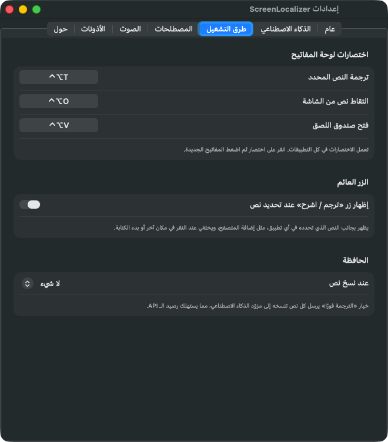
  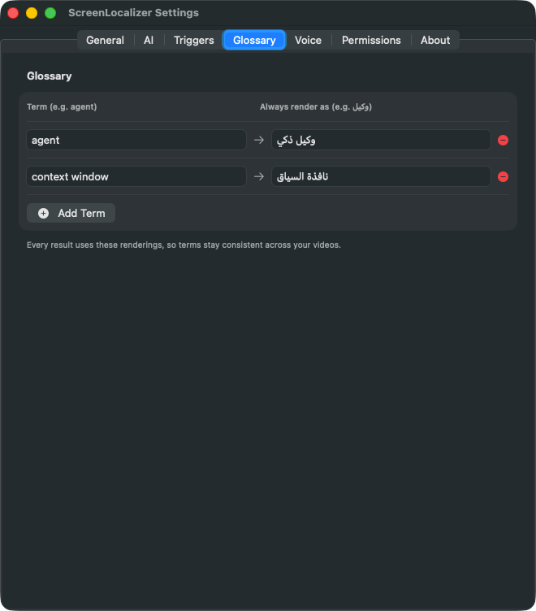
</p>

**🇸🇦 الواجهة العربية:** إذا كان نظام الماك لديك بالعربية، تظهر قوائم ScreenLocalizer ونوافذه بالعربية ومن اليمين إلى
اليسار. ويمكنك أيضًا اختيارها لهذا التطبيق وحده من **الإعدادات ← عام ← لغة الواجهة**.

### تحديث تطبيق الماك

1. حمّل ملف **ScreenLocalizer-mac.dmg** الجديد (أو استخدم **التحقق من التحديثات…** من القائمة).
2. أغلق ScreenLocalizer (أيقونة شريط القوائم ← **إنهاء ScreenLocalizer**).
3. اسحب التطبيق الجديد إلى **التطبيقات** واختر **استبدال**.
4. افتحه. وإذا حظره macOS مرة أخرى، كرّر خطوة **فتح على أي حال**.
5. لأن التطبيق غير موقّع بعد بشهادة Apple مدفوعة، قد ينسى macOS أذوناته بعد التحديث. إذا توقف الاختصار أو مربع الشاشة
   عن العمل: افتح **إعدادات النظام ← الخصوصية والأمان ← تسهيلات الاستخدام**، وحدّد ScreenLocalizer، واضغط **−**
   لإزالته، ثم فعّله من جديد من داخل التطبيق (**الإعدادات ← الأذونات ← منح…**). وافعل الشيء نفسه مع **تسجيل الشاشة**.

---

## 🔒 الخصوصية في دقيقة

- **لا حسابات، ولا تتبّع، ولا تحليلات، ولا إعلانات، ولا خادم خاص بـ ScreenLocalizer.**
- يُرسَل النص **فقط عندما تطلب**، و**فقط إلى خدمة الذكاء الاصطناعي التي اخترتها** (OpenAI افتراضيًا).
- **مفتاحك يبقى على جهازك** (في تخزين المتصفح أو في سلسلة مفاتيح macOS).
- قراءة الشاشة (OCR) تتم **على جهازك**، والسجل يبقى **على جهازك**.

التفاصيل الكاملة: [PRIVACY.md](PRIVACY.md).

---

## ❓ أسئلة وأجوبة

<details>
<summary><b>هل ScreenLocalizer مجاني؟</b></summary>

نعم، البرنامج مجاني للاستخدام الشخصي غير التجاري. تدفع فقط لـ OpenAI (أو للخدمة التي اخترتها) مقابل ما تستخدمه، وهو
عادةً أقل من سنت للفقرة الواحدة.
</details>

<details>
<summary><b>أنا مشترك في ChatGPT Plus، هل ما زلت أحتاج مفتاحًا؟</b></summary>

نعم. اشتراك ChatGPT وواجهة OpenAI البرمجية (API) يُحاسَبان بشكل منفصل. أضف رصيدًا صغيرًا من
<https://platform.openai.com> ← Settings ← Billing.
</details>

<details>
<summary><b>يقول إن مفتاحي خاطئ، أو تظهر رسالة «حد الاستخدام / الرصيد».</b></summary>

- **مفتاح خاطئ (401):** انسخ المفتاح من جديد بعناية (يبدأ بـ `sk-`) والصقه واحفظه.
- **حد الاستخدام أو الرصيد (429):** لا يوجد رصيد في حساب OpenAI. أضف رصيدًا من صفحة Billing.
</details>

<details>
<summary><b>هل يعمل على ويندوز؟</b></summary>

**إضافة المتصفح** تعمل في Chrome وEdge على ويندوز وماك ولينكس. أما **تطبيق الماك** فهو لأجهزة الماك بمعالجات Apple فقط.
</details>

<details>
<summary><b>عندي ماك قديم بمعالج Intel.</b></summary>

ملف التحميل الجاهز مخصص لأجهزة الماك بمعالجات Apple. لكن يمكنك استخدام **إضافة المتصفح**.
</details>

<details>
<summary><b>هل يمكنني استخدام خدمات ذكاء اصطناعي أخرى، أو نموذج محلي مجاني؟</b></summary>

في **تطبيق الماك** نعم: الإعدادات ← الذكاء الاصطناعي ← المزوّد. اختر **OpenRouter** أو **Groq** أو **Ollama (محلي)** أو
**LM Studio (محلي)** أو **مخصص** لأي خدمة متوافقة مع OpenAI. النماذج المحلية تعمل على جهازك مجانًا ودون إنترنت.
أما **الإضافة** فتدعم OpenAI فقط حاليًا.
</details>

<details>
<summary><b>الزر العائم لا يظهر في بعض التطبيقات (على الماك).</b></summary>

بعض التطبيقات لا تخبر macOS بالنص الذي حددته. استخدم الاختصار **⌃⌥T** بدلًا منه (فهو قادر على نسخ التحديد بنفسه)،
أو مربع الشاشة **⌃⌥O**. وتأكد كذلك من **الإعدادات ← الأذونات ← تسهيلات الاستخدام**.
</details>

<details>
<summary><b>الاختصار لا يفعل شيئًا.</b></summary>

ربما يستخدم تطبيق آخر نفس المفاتيح. اختر مفاتيح أخرى من **الإعدادات ← طرق التشغيل**. وإذا توقف بعد تحديث مباشرةً،
فأعد منح الأذونات (انظر **تحديث تطبيق الماك** أعلاه).
</details>

<details>
<summary><b>اللوحة تظهر في تسجيل الشاشة.</b></summary>

اضغط شارة **ظاهرة** أعلى اللوحة لتصبح **مخفية**. الوضع المخفي هو الافتراضي، ويمكن تغييره من **الإعدادات ← عام**.
</details>

<details>
<summary><b>الماك يرفض فتح التطبيق («لم يتمكن من التحقق»).</b></summary>

اتبع الخطوتين ٥ و٦ من دليل التثبيت (**إعدادات النظام ← الخصوصية والأمان ← فتح على أي حال**). ويمكن للمستخدمين
التقنيين أيضًا تشغيل هذا الأمر في Terminal: `xattr -dr com.apple.quarantine /Applications/ScreenLocalizer.app`
</details>

<details>
<summary><b>أين يُحفَظ السجل؟ وكيف أحذفه؟</b></summary>

في الملف `~/Library/Application Support/ScreenLocalizer/history.json` على جهازك. يمكنك حذف عناصر أو حذف الكل من نافذة
السجل، أو إيقاف السجل من **الإعدادات ← عام**.
</details>

<details>
<summary><b>كيف ألغي التثبيت؟</b></summary>

- **الإضافة:** `chrome://extensions` ← ScreenLocalizer ← **Remove** (إزالة)، ثم احذف مجلدها.
- **تطبيق الماك:** أيقونة شريط القوائم ← **إنهاء ScreenLocalizer**، ثم اسحب التطبيق من مجلد التطبيقات إلى سلة المهملات.
  وللتنظيف الكامل (اختياري): احذف المجلد `~/Library/Application Support/ScreenLocalizer`، واحذف المفتاح المسمّى
  "ScreenLocalizer API key" من تطبيق **Keychain Access** (الوصول إلى سلسلة المفاتيح)، وأزل ScreenLocalizer من قوائم
  **الخصوصية والأمان**.
</details>

<details>
<summary><b>هل يمكنني مشاركة ScreenLocalizer مع أصدقائي؟</b></summary>

نعم، شارك **رابط هذه الصفحة**: <https://github.com/eyoussef-builds/screenlocalizer>.
لكن من فضلك لا ترسل الملفات نفسها ولا ترفعها في أي مكان آخر؛ يجب أن يحمّل الجميع النسخة الرسمية من هنا (وهكذا تصلهم
التحديثات أيضًا).
</details>

<details>
<summary><b>هل يمكنني استخدامه في عملي التجاري أو قناتي الربحية؟</b></summary>

الترخيص يسمح بالاستخدام **الشخصي غير التجاري** فقط. إذا أردت استخدام ScreenLocalizer في عمل يدرّ دخلًا — لشركة، أو لعملاء،
أو في قناة تحقق أرباحًا — راسلنا على **hello@eyoussef.me** لنتحدث عن ترخيص تجاري.
</details>

ما زلت تواجه مشكلة؟ [افتح بلاغًا (Issue)](https://github.com/eyoussef-builds/screenlocalizer/issues/new/choose) بالعربية أو
الإنجليزية.

---

## 🛠️ للمطورين

هيكل المشروع وأوامر البناء (التفاصيل في [CONTRIBUTING.md](CONTRIBUTING.md) و[mac/README.md](mac/README.md)):

</div>

```
extension/        Browser extension (Manifest V3, plain JavaScript — no build step)
mac/              Mac app (Swift, SwiftUI + AppKit, macOS 14+)
docs/images/      Screenshots used in these guides
scripts/          Packaging for the extension
.github/          CI, release workflow, issue templates
```

```bash
scripts/package-extension.sh          # → dist/ScreenLocalizer-extension.zip
mac/scripts/build-app.sh              # → mac/build/ScreenLocalizer.app
mac/scripts/package-dmg.sh            # → mac/build/ScreenLocalizer-mac.dmg
python3 mac/scripts/check-strings.py  # هل كل نصوص الواجهة مترجمة للعربية؟
python3 mac/scripts/mock-openai.py    # خادم ذكاء اصطناعي وهمي للتجربة دون مفتاح
```

<div dir="rtl">

---

## 📜 الترخيص

ScreenLocalizer **مجاني للاستخدام الشخصي فقط**، بموجب [**ترخيص الاستخدام الشخصي لـ ScreenLocalizer**](LICENSE).
الكود منشور للعلن لتعرف كيف يعمل وتثق به، لكنه **ليس مفتوح المصدر**.

بكلمات بسيطة (والنص القانوني في ملف [LICENSE](LICENSE) هو المرجع):

- ✅ **يمكنك** تحميله وتثبيته واستخدامه مجانًا على أجهزتك، لأغراض شخصية غير تجارية.
- ✅ **يمكنك** قراءة الكود، وبناء التطبيق بنفسك، وتعديل نسختك الخاصة لاستخدامك أنت.
- ✅ **يمكنك** مشاركة **رابط** هذه الصفحة مع أي شخص.
- ❌ **لا يمكنك** نسخ ScreenLocalizer أو إعادة رفعه أو مشاركته أو نشره — هو أو نسخة معدّلة منه — في أي مكان آخر، سواء
  مجانًا أو مقابل مال. (عمل Fork على GitHub مسموح فقط لإرسال التحسينات إلى هذا المستودع).
- ❌ **لا يمكنك** بيعه أو إعادة بيعه أو استخدامه تجاريًا: لا منتجات أو خدمات مدفوعة، ولا عمل لشركة أو لعملاء، ولا محتوى
  يحقق أرباحًا — إلا بترخيص تجاري مكتوب.

للترخيص التجاري أو أي إذن آخر: **hello@eyoussef.me**.

---

## 🤝 المساهمة والدعم والتواصل

- 🐞 وجدت مشكلة أو لديك فكرة؟ [افتح بلاغًا](https://github.com/eyoussef-builds/screenlocalizer/issues/new/choose).
- 🧑‍💻 تريد المساعدة في الكود أو الترجمة؟ اقرأ [CONTRIBUTING.md](CONTRIBUTING.md).
- 🔒 مشكلة أمنية؟ راجع [SECURITY.md](SECURITY.md) — ومن فضلك أبلغ عنها بشكل خاص.
- 💜 كن لطيفًا: [قواعد السلوك](CODE_OF_CONDUCT.md).

**من تطوير إسلام يوسف (Eslam Youssef)** · ✉️ [hello@eyoussef.me](mailto:hello@eyoussef.me) · 🌐 [eyoussef.me](https://eyoussef.me) · GitHub [@eyoussef-builds](https://github.com/eyoussef-builds)

</div>
