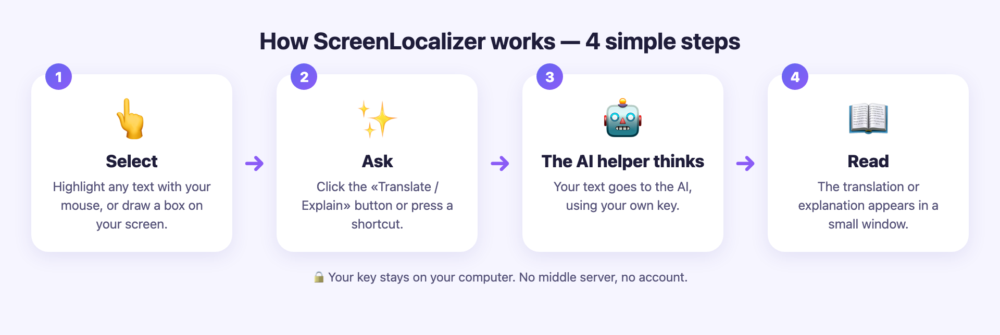
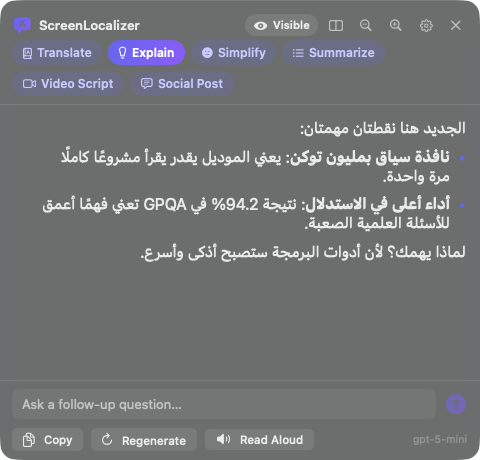
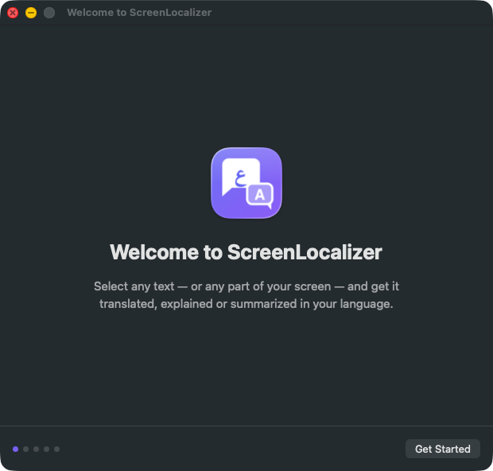
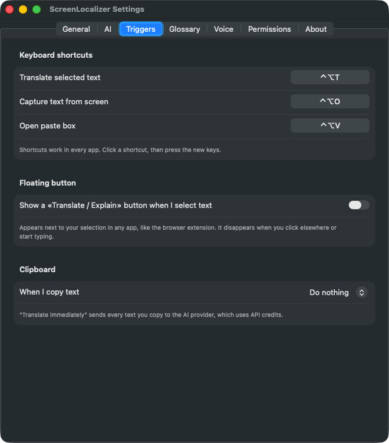

<p align="center">
  
</p>

<p align="center">
  <a href="README.ar.md"><b>🇸🇦 اقرأ هذا الدليل بالعربية</b></a> ·
  <a href="#-download">Download</a> ·
  <a href="#-part-1--the-browser-extension">Extension guide</a> ·
  <a href="#-part-2--the-mac-app">Mac app guide</a> ·
  <a href="#-questions--answers">Q&amp;A</a>
</p>

<p align="center">
  <a href="https://github.com/eyoussef-builds/screenlocalizer/releases/latest"></a>
  <a href="LICENSE"></a>
  
  
</p>

---

## 👋 What is ScreenLocalizer?

Imagine you have a friend who speaks **English and your language**. Whenever you point at
something written in English — a news article, a PDF, a tweet, even words inside a picture or a
paused video — your friend leans over and tells you **what it says, what it means, or the short
version**.

**ScreenLocalizer is that friend, living inside your computer.**

1. You **select** some text (or draw a box around it on your screen).
2. You click a small button or press a shortcut.
3. A little window opens and shows the text **translated, explained, simplified or summarized** in
   your language.

<p align="center"></p>

It was made for **content creators** who read English news and present it to an audience in
another language (for example Arabic), but anyone who reads English and thinks in another language
can use it — students, researchers, curious people.

### What can it do?

| Mode | What you get | Extension | Mac app |
|---|---|:---:|:---:|
| 📘 **Translate** | A natural translation that keeps tech words like "AI agent" in English | ✅ | ✅ |
| 💡 **Explain** | Not word-for-word: *what it means and why it matters*, like explaining it on camera | ✅ | ✅ |
| 🙂 **Simplify** | The idea in very simple words, with an everyday example | ✅ | ✅ |
| 📝 **Summarize** | 3–6 short bullet points | ✅ | ✅ |
| 🎬 **Video Script** | A ready-to-read script for your next video | | ✅ |
| 💬 **Social Post** | A tweet (X post) and a LinkedIn post about it | | ✅ |
| ❓ **Follow-up questions** | Ask "what does that mean?" about the same text | | ✅ |

Results can be in **Arabic or almost any other language** — you choose.

---

## 🧩 Two versions — pick one (or use both)

| | 🌐 **Browser extension** | 💻 **Mac app** |
|---|---|---|
| **Works in** | Web pages in Chrome or Microsoft Edge (Windows, Mac, Linux) | **Every app** on your Mac: browsers, PDFs, Notes, Slack, Telegram… and text inside images or videos |
| **How you start it** | Select text → purple button | Select text → shortcut `⌃⌥T`, floating button, screen box `⌃⌥O`, or paste box `⌃⌥V` |
| **Extras** | — | Hidden-from-recording panel, follow-up chat, read aloud, history & export, glossary, video script, social post |
| **AI services** | OpenAI | OpenAI or any OpenAI-compatible service (OpenRouter, Groq, Ollama…) |
| **Needs** | Chrome or Edge | A Mac with an Apple chip (M1 or newer) and macOS 14 Sonoma or newer |

Both are **free for personal use** (see [License](#-license)).

---

## 📥 Download

| What | Download |
|---|---|
| 🌐 Browser extension | [**ScreenLocalizer-extension.zip**](https://github.com/eyoussef-builds/screenlocalizer/releases/latest/download/ScreenLocalizer-extension.zip) |
| 💻 Mac app | [**ScreenLocalizer-mac.dmg**](https://github.com/eyoussef-builds/screenlocalizer/releases/latest/download/ScreenLocalizer-mac.dmg) |

All versions and release notes: [Releases page](https://github.com/eyoussef-builds/screenlocalizer/releases).

---

## 🔑 Before you start: get your AI key (about 5 minutes)

**The simple idea:** ScreenLocalizer doesn't have its own brain. It *borrows* one from an AI company
— by default **OpenAI**, the company that makes ChatGPT. To borrow it, you need a **key**: a long
secret password that starts with `sk-`. OpenAI then charges you a tiny amount for what you use.

> 💰 **How much?** Translating or explaining a paragraph usually costs **less than one cent**.
> Adding $5 of credit lasts most people a long time.
>
> ⚠️ **ChatGPT Plus is not the same thing.** A ChatGPT subscription does *not* include API
> credit — the key needs its own small balance.

**Step by step:**

1. Go to **<https://platform.openai.com>** and sign up or log in (you can use the same account as ChatGPT).
2. Open **Settings → Billing** and add a payment method and a small amount of credit (for example $5).
3. Open **<https://platform.openai.com/api-keys>** and click **Create new secret key**.
4. Give it a name like `ScreenLocalizer` and click **Create secret key**.
5. Click **Copy**. The key looks like `sk-proj-…` and is very long.
6. Keep it somewhere safe (for example, a password manager). **OpenAI shows it only once**, and
   anyone who has it can spend your credit — **never share it or post it online**.

You'll paste this key into ScreenLocalizer in a moment. It stays **on your computer** and is only
ever sent to OpenAI.

---

## 🌐 Part 1 — The browser extension

### How it works (explained like you're five)

When you open a web page, the extension waits quietly in the background. The moment you highlight
some words with your mouse, a little purple button pops up next to them: **«ترجم / اشرح»**
(*Translate / Explain*).

<p align="center"></p>

Click it, and a small window opens next to your words. The extension sends **only those words** to
OpenAI (using your key), and the answer appears in the window **word by word, as if someone were
typing it for you**. Want a different kind of answer? Click another mode at the top —
**ترجمة** (Translate), **شرح** (Explain), **تبسيط** (Simplify) or **تلخيص** (Summarize).

<p align="center"></p>

<details>
<summary><b>🔧 For curious grown-ups: what happens behind the scenes</b></summary>

- `content.js` runs on each page. It notices your selection, shows the button and draws the result
  window inside a *closed shadow DOM*, so the page's own styles can't break it (and it can't break
  the page).
- `background.js` (the service worker) receives the text, builds instructions for the chosen mode
  and streams the answer from the OpenAI Chat Completions API back to the window.
- Your key and settings live in the browser's extension storage on your computer.
- Nothing is sent anywhere until you click the button, use the right-click menu or the shortcut.

</details>

### Install it — step by step

> The extension isn't in the Chrome Web Store yet, so you install it with Chrome's
> **"Load unpacked"** option. It looks technical, but it's just a few clicks.

1. **Download** [ScreenLocalizer-extension.zip](https://github.com/eyoussef-builds/screenlocalizer/releases/latest/download/ScreenLocalizer-extension.zip).
2. **Unzip it.**
   - **Mac:** double-click the file. A folder named `ScreenLocalizer-extension` appears.
   - **Windows:** right-click the file → **Extract All…** → **Extract**.
3. **Move that folder somewhere it can stay**, for example your **Documents** folder.
   The browser loads the extension from this folder every time, so **don't delete it**.
4. Open **Chrome** and type `chrome://extensions` in the address bar, then press **Enter**.
   (In **Microsoft Edge**, type `edge://extensions`.)
5. Turn on **Developer mode** — a switch in the **top-right** corner in Chrome (in Edge it's in
   the **left** sidebar).
6. Click **Load unpacked** and choose the `ScreenLocalizer-extension` folder.
7. **Pin it** so it's easy to find: click the puzzle-piece icon 🧩 next to the address bar, then the
   📌 pin next to **ScreenLocalizer**.
8. The **settings page** opens by itself (if not: click the ScreenLocalizer icon → **⚙️ الإعدادات**).
   Paste your key into **مفتاح OpenAI API**, click **حفظ** (*Save*), then **اختبار المفتاح**
   (*Test key*). You should see **✓ المفتاح يعمل** (*the key works*).

<p align="center">
  
  
</p>

🎉 **Done!** Open any article in English, select a sentence, and click the purple button.

### Use it

- **Select text → click «ترجم / اشرح».** The window opens next to your text.
- **Switch modes** with the buttons at the top of the window. Each answer is remembered while the
  window is open, so switching back is instant.
- **📋 نسخ** (*Copy*) copies the answer. **↻ إعادة** (*Again*) asks for a fresh answer.
- **Move the window** by dragging its purple top bar. Close it with **✕** or the **Esc** key.
- **Other ways to start it:** right-click selected text → **ScreenLocalizer: ترجم أو اشرح**, or press
  **Ctrl + Shift + Y** (Windows) / **⌘ + Shift + Y** (Mac).
- **Settings** (click the toolbar icon → ⚙️):
  - **لغة الناتج** (*output language*) — Arabic by default; type any language, e.g. `French`.
  - **الموديل** (*model*) — `gpt-5-mini` by default: fast, cheap and good at translation.
  - **الوضع الافتراضي** (*default mode*) — which mode opens first.
  - **تعليمات إضافية** (*extra instructions*) — e.g. "My audience loves AI news; keep it simple."
  - Turn the floating button off if you only want the right-click menu or shortcut.

### Update it

1. Download the new zip and unzip it.
2. Replace the files inside your `ScreenLocalizer-extension` folder with the new ones.
3. Open `chrome://extensions` and click the **↻ reload** arrow on the ScreenLocalizer card.
   Your key and settings are kept.

---

## 💻 Part 2 — The Mac app

### How it works (explained like you're five)

The Mac app is the same helpful friend, but it doesn't live inside one browser — it lives in your
Mac's **top menu bar** (look for a small speech-bubble icon), so it can help you **in every app**.

You can call it in **four ways**:

| Way | What you do | Good for |
|---|---|---|
| ⌨️ **Shortcut** | Select text anywhere, then press **⌃⌥T** | The fastest way, in any app |
| 🟣 **Floating button** | Select text — a «Translate / Explain» button appears; click it | Like the extension, but everywhere |
| 🔲 **Screen box (OCR)** | Press **⌃⌥O**, then drag a box around **any** text on screen | Text you can't select: images, slides, video frames, charts |
| 📋 **Paste box** | Press **⌃⌥V**, paste or type text, press **⌘↩** | Text from anywhere else |

> **What do ⌃ and ⌥ mean?** ⌃ is the **Control** key and ⌥ is the **Option** key (bottom-left of
> your keyboard). "⌃⌥T" means: **hold Control and Option together, then tap T**.

<p align="center"></p>

<p align="center"></p>

A small window — the **panel** — then shows the answer. It floats above your other windows **without
taking focus away** from what you're reading.

<p align="center">
  
  
</p>

**🔒 Your secret teleprompter.** By default the panel is **Private**: macOS leaves it out of
screenshots and screen recordings made with its standard capture system (used by the built-in
screenshot tool, QuickTime, OBS and most modern recorders). You can read the translation while you
record, and your viewers only see the English page. Click the **Private** badge at the top of the
panel to switch it to **Visible** when you *want* viewers to see it.
*Tip: do a 5-second test recording with your own recorder before an important session.*

<details>
<summary><b>🔧 For curious grown-ups: what happens behind the scenes</b></summary>

- **Reading your selection:** the app asks macOS's Accessibility system for the selected text. If an
  app doesn't share it, ScreenLocalizer briefly sends ⌘C, reads the clipboard, and then **restores
  whatever was on your clipboard before**.
- **Screen box:** the area you draw is captured with ScreenCaptureKit (ScreenLocalizer's own windows
  are left out) and read **on your Mac** by Apple's Vision text recognition. Only the recognized
  text goes to the AI; the image is never saved or uploaded.
- **AI:** the text plus instructions for the chosen mode are streamed from an OpenAI-compatible
  Chat Completions API. Your key is kept in the **macOS Keychain**.
- **Private mode:** the panel is marked as excluded from screen capture by macOS.
- **History** is a file on your Mac; nothing is synced anywhere.

</details>

### Install it — step by step

**You need:** a Mac with an **Apple chip** (M1, M2, M3, M4 or newer) and **macOS 14 Sonoma or newer**.
(Not sure? Click the Apple menu in the top-left corner → **About This Mac**; it shows "Chip" and "macOS".)

1. **Download** [ScreenLocalizer-mac.dmg](https://github.com/eyoussef-builds/screenlocalizer/releases/latest/download/ScreenLocalizer-mac.dmg).
2. **Double-click** the downloaded file. A window opens with the ScreenLocalizer icon and an
   **Applications** folder.
3. **Drag** the ScreenLocalizer icon **onto the Applications folder**. Then close that window.
4. Open your **Applications** folder (Finder → Applications) and **double-click ScreenLocalizer**.
5. macOS shows a message like **"Apple could not verify ScreenLocalizer…"**. This is expected:
   the app isn't signed with a paid Apple developer certificate yet. Click **Done**
   (*not* "Move to Trash").
6. Open the Apple menu (top-left corner) → **System Settings** → **Privacy & Security**. Scroll down to the
   **Security** section — you'll see *"ScreenLocalizer was blocked to protect your Mac"*.
   Click **Open Anyway**, enter your Mac password (or use Touch ID), and click **Open Anyway** again.
7. The **welcome window** appears. 🎉 You only have to do steps 5–6 once.

### First-time setup — step by step

The welcome window walks you through five short steps.

<p align="center"></p>

**1. Welcome** → click **Get Started**.

**2. Pick your language.** Choose the language you want answers in (for example *Arabic — العربية*),
then **Continue**.

<p align="center"></p>

**3. Connect your AI.** Leave **Provider** on **OpenAI**. Paste your key into **API key**, click
**Save Key**, then **Test Connection**. When you see **✓ Connected**, click **Continue**.
(The app picks a good model automatically; `gpt-5-mini` is a great default.)

<p align="center"></p>

**4. Allow access.** macOS protects your screen and other apps, so it asks *you* to allow two things:

<p align="center"></p>

- **Accessibility** — lets ScreenLocalizer read the text you select in other apps.
  Click **Grant…**. System Settings opens at **Privacy & Security → Accessibility**. Find
  **ScreenLocalizer** in the list and **switch it on** (enter your password if asked).
- **Screen Recording** — lets ScreenLocalizer read text inside the box you draw.
  Click **Grant…**, switch **ScreenLocalizer** on in **Privacy & Security → Screen & System Audio
  Recording** (called **Screen Recording** on macOS 14). If macOS says the app must **quit and reopen**, click **Quit & Reopen** (or use the
  **Relaunch ScreenLocalizer** button).

The orange marks turn into green ✓ when access is granted. Then click **Continue**.

> 🤔 **Is this safe?** Accessibility is only used to read the text *you* select. Screen Recording is
> only used to capture the box *you* draw — ScreenLocalizer never records video, and nothing is sent
> anywhere except the text, to the AI service you chose.

**5. You're all set!** Keep **Open ScreenLocalizer at login** ticked if you want it ready every time
your Mac starts, then click **Start Using ScreenLocalizer**.

<p align="center"></p>

ScreenLocalizer now lives in your **menu bar** (top-right of the screen). Try it: select any English
sentence — even in this page — and press **⌃⌥T**.

### Use it

#### The panel

| Button | What it does |
|---|---|
| **Private / Visible** | Hide the panel from screen recordings (Private) or show it (Visible) |
| ▭▭ | Show the **original text side by side** with the answer |
| 🔍− / 🔍+ | Make the text **smaller or bigger** (great as a teleprompter) |
| ⚙️ | Open **Settings** |
| ✕ | Close the panel (or press **Esc**) |
| Mode buttons | **Translate · Explain · Simplify · Summarize · Video Script · Social Post** |
| *Ask a follow-up question…* | Type a question about the same text and press **Return** |
| **Copy** | Copy the answer (and follow-ups) |
| **Regenerate** | Get a fresh answer |
| **Read Aloud** | Listen to the answer (press again to stop) |

You can **drag** the panel by its top area and **resize** it from its edges. While it's open, new answers appear in the same place.

<p align="center"></p>

#### The menu bar icon

Click the speech-bubble icon in the menu bar for: **Translate Selection**, **Capture Text from
Screen…**, **Paste Box**, **Show Last Result**, **Default Mode**, turning the **floating button** on or
off, **Hide Panel from Screen Recordings**, **History…**, **Settings…** and **Check for Updates…**.

#### History

Every answer is saved **on your Mac** so you can find it again: menu bar icon → **History…**.
Search, filter by mode, copy, reopen in the panel, or **Export** a whole session as one Markdown file —
handy as a script for your next video.

<p align="center"></p>

#### Settings

Menu bar icon → **Settings…**

| Tab | What you can change |
|---|---|
| **General** | Answer language, default mode, custom instructions, panel privacy default, text size, history on/off, interface language (English / العربية), open at login |
| **AI** | Provider (OpenAI, OpenRouter, Groq, Ollama, LM Studio, Custom), base URL, API key, model, test connection |
| **Triggers** | Change the three shortcuts, turn the floating button on/off, choose what happens when you copy text |
| **Glossary** | Your own word list, e.g. `agent → وكيل ذكي`, so every answer uses the same terms |
| **Voice** | Read aloud with free built-in macOS voices or natural OpenAI voices |
| **Permissions** | See whether Accessibility and Screen Recording are allowed |
| **About** | Version, links, and **Check for Updates** |

<p align="center">
  
  
</p>

**🇸🇦 Arabic interface:** if your Mac is set to Arabic, ScreenLocalizer's menus and windows appear in
Arabic, right-to-left. You can also choose it just for this app in **Settings → General →
Interface language**.

<p align="center"></p>

### Update the Mac app

1. Download the new **ScreenLocalizer-mac.dmg** (or use **Check for Updates…** in the menu).
2. Quit ScreenLocalizer (menu bar icon → **Quit ScreenLocalizer**).
3. Drag the new app onto **Applications** and choose **Replace**.
4. Open it. If macOS blocks it again, repeat the **Open Anyway** step.
5. From version 1.0.1 on, updates keep ScreenLocalizer's permissions. (Updating from 1.0.0 is the one
   exception: macOS asks once more.) If the shortcut or the screen box ever stops working after an
   update, open **Settings → Permissions** in the app, click **Reset Permissions & Try Again**, and
   switch ScreenLocalizer on in the list that opens. If ScreenLocalizer appears in that list more than
   once, remove the extra entries with **−**. If macOS asks whether ScreenLocalizer may use your saved
   key, click **Always Allow**.

---

## 🔒 Privacy in one minute

- **No account, no tracking, no analytics, no ads, no ScreenLocalizer server.**
- Text is sent **only when you ask**, and **only to the AI service you chose** (OpenAI by default).
- Your **key stays on your device** (browser storage or the macOS Keychain).
- Screen reading (OCR) happens **on your Mac**. History stays **on your Mac**.

Full details: [PRIVACY.md](PRIVACY.md).

---

## ❓ Questions & answers

<details>
<summary><b>Is ScreenLocalizer free?</b></summary>

Yes — the software is free for personal, non-commercial use. You only pay OpenAI (or your chosen AI
service) for what you use, usually less than a cent per paragraph.
</details>

<details>
<summary><b>I pay for ChatGPT Plus. Do I still need a key?</b></summary>

Yes. ChatGPT subscriptions and the OpenAI API are billed separately. Add a small credit balance at
<https://platform.openai.com> → Settings → Billing.
</details>

<details>
<summary><b>It says my key is wrong, or "rate limit / quota".</b></summary>

- **Wrong key (401):** copy the key again carefully (it starts with `sk-`), paste it, and save.
- **Rate limit / quota (429):** your OpenAI account has no credit left. Add credit in Billing.
</details>

<details>
<summary><b>Does it work on Windows?</b></summary>

The **browser extension** works in Chrome and Edge on Windows, Mac and Linux. The **Mac app** is only
for Macs with Apple chips.
</details>

<details>
<summary><b>I have an older Intel Mac.</b></summary>

The ready-made download is for Apple-chip Macs. You can still use the **browser extension**.
</details>

<details>
<summary><b>Can I use other AI services, or a free local model?</b></summary>

In the **Mac app**, yes: Settings → AI → Provider. Choose **OpenRouter**, **Groq**, **Ollama (local)**,
**LM Studio (local)** or **Custom** for any OpenAI-compatible service. Local models run on your Mac,
for free, without internet. The **extension** currently supports OpenAI only.
</details>

<details>
<summary><b>The floating button doesn't appear in some app (Mac).</b></summary>

Some apps don't tell macOS what you selected. Use the shortcut **⌃⌥T** instead (it can copy the
selection for you), or the screen box **⌃⌥O**. Also check **Settings → Permissions → Accessibility**.
</details>

<details>
<summary><b>The shortcut does nothing.</b></summary>

Another app may already use the same keys. Choose different ones in **Settings → Triggers**. If it
stopped working right after an update, open **Settings → Permissions** and click **Reset Permissions &
Try Again**.
</details>

<details>
<summary><b>The panel shows up in my screen recording.</b></summary>

Click the **Visible** badge at the top of the panel so it says **Private**. Private is the default and
can be changed in **Settings → General**.
</details>

<details>
<summary><b>The Mac won't open the app ("could not verify").</b></summary>

Follow steps 5–6 of the install guide (**System Settings → Privacy & Security → Open Anyway**).
Technical users can also run `xattr -dr com.apple.quarantine /Applications/ScreenLocalizer.app` in
Terminal.
</details>

<details>
<summary><b>Where is my history stored? How do I delete it?</b></summary>

In `~/Library/Application Support/ScreenLocalizer/history.json` on your Mac. Delete items or
everything in the History window, or turn history off in **Settings → General**.
</details>

<details>
<summary><b>How do I uninstall?</b></summary>

- **Extension:** `chrome://extensions` → ScreenLocalizer → **Remove**, then delete its folder.
- **Mac app:** menu bar icon → **Quit ScreenLocalizer**, drag the app from Applications to the Trash.
  Optional clean-up: delete `~/Library/Application Support/ScreenLocalizer`, remove the API key named
  "ScreenLocalizer API key" in the **Keychain Access** app, and remove ScreenLocalizer from **Privacy &
  Security** lists.
</details>

<details>
<summary><b>Can I share ScreenLocalizer with my friends?</b></summary>

Yes — share **the link to this page**: <https://github.com/eyoussef-builds/screenlocalizer>.
Please don't send the files themselves or upload them anywhere else; everyone should download the
official version from here (that's also how they get updates).
</details>

<details>
<summary><b>Can I use it for my business or my paid channel?</b></summary>

The license allows **personal, non-commercial** use only. If you'd like to use ScreenLocalizer for work that
earns money — for a company, for clients, or on a monetized channel — email
**hello@eyoussef.me** to ask about a commercial license.
</details>

Still stuck? [Open an issue](https://github.com/eyoussef-builds/screenlocalizer/issues/new/choose) —
in English or Arabic.

---

## 🛠️ For developers

```
extension/        Browser extension (Manifest V3, plain JavaScript — no build step)
mac/              Mac app (Swift, SwiftUI + AppKit, macOS 14+) — see mac/README.md
docs/images/      Screenshots used in these guides
scripts/          Packaging for the extension
.github/          CI, release workflow, issue templates
```

```bash
# Browser extension: load the extension/ folder with "Load unpacked", or package it:
scripts/package-extension.sh          # → dist/ScreenLocalizer-extension.zip

# Mac app (Command Line Tools are enough; Xcode is optional):
mac/scripts/build-app.sh              # → mac/build/ScreenLocalizer.app
mac/scripts/package-dmg.sh            # → mac/build/ScreenLocalizer-mac.dmg
python3 mac/scripts/check-strings.py  # every interface string translated into Arabic?
python3 mac/scripts/mock-openai.py    # fake AI server for testing without a key
```

Pushing a tag like `v1.1.0` builds both downloads and attaches them to a GitHub release.
Read [CONTRIBUTING.md](CONTRIBUTING.md) before opening a pull request.

---

## 📜 License

ScreenLocalizer is **free for personal use only**, under the
[**ScreenLocalizer Personal Use License**](LICENSE). The code is public so you can see how it works
and trust it — but it is **not open source**.

In plain words (the [LICENSE](LICENSE) file is what legally counts):

- ✅ **You can** download, install and use it for free on your own devices, for personal,
  non-commercial purposes.
- ✅ **You can** read the code, build it yourself, and change your own copy for your own use.
- ✅ **You can** share the **link** to this page with anyone.
- ❌ **You can't** copy, re-upload, share or publish ScreenLocalizer — or a changed version of it —
  anywhere else, whether for free or for money. (Forking on GitHub is only for sending improvements
  back here.)
- ❌ **You can't** sell or resell it, or use it commercially: no paid products or services, no
  business or client work, and no monetized content — unless you have a written commercial license.

For a commercial license or any other permission: **hello@eyoussef.me**.

---

## 🤝 Contributing, support & contact

- 🐞 Found a bug or have an idea? [Open an issue](https://github.com/eyoussef-builds/screenlocalizer/issues/new/choose).
- 🧑‍💻 Want to help with code or translations? Read [CONTRIBUTING.md](CONTRIBUTING.md).
- 🔒 Security problem? See [SECURITY.md](SECURITY.md) — please report privately.
- 💜 Be kind: [Code of Conduct](CODE_OF_CONDUCT.md).

**Made by Eslam Youssef** · ✉️ [hello@eyoussef.me](mailto:hello@eyoussef.me) · 🌐 [eyoussef.me](https://eyoussef.me) · GitHub [@eyoussef-builds](https://github.com/eyoussef-builds)
